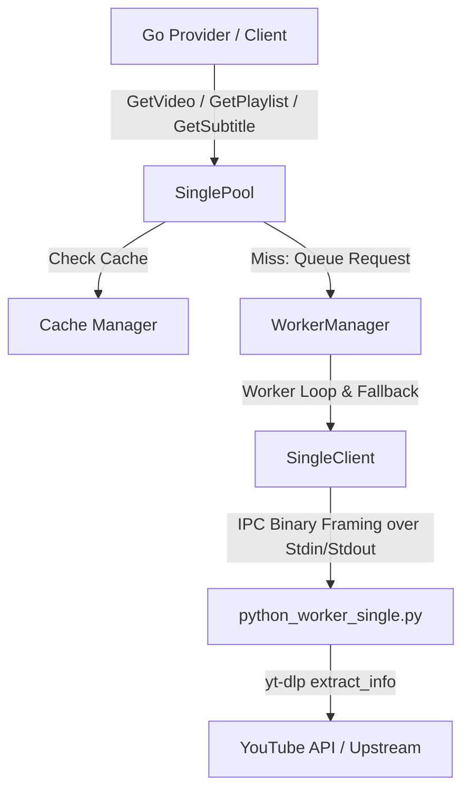

The yt-dlp metadata processing pipeline in Askito utilizes a persistent Python worker pool architecture communicating over binary-framed stdin/stdout IPC streams from Go, integrated with a local caching layer and robust retry/recovery logic. Below is the complete code and architecture summary.

### Architecture Overview



---

### Package & File Summary

#### 1. Package `ytdlp` (`internal/youtube/metadata/ytdlp/`)

- [`internal/youtube/metadata/ytdlp/client.go`](internal/youtube/metadata/ytdlp/client.go:1)
  - **Types**: [`Client`](internal/youtube/metadata/ytdlp/client.go:15) (`pool *python.SinglePool`, `logger *logger.Logger`)
  - **Functions/Methods**:
    - [`NewClient(pool *python.SinglePool, logger *logger.Logger) *Client`](internal/youtube/metadata/ytdlp/client.go:25) - **Input**: Pool and logger. **Output**: `*Client`.
    - [`(c *Client) Cleanup() error`](internal/youtube/metadata/ytdlp/client.go:33) - **Input**: None. **Output**: `error`.
    - [`(c *Client) ValidateYTDLP() error`](internal/youtube/metadata/ytdlp/client.go:38) - **Input**: None. **Output**: `error` (checks `yt-dlp` binary existence).
    - [`(c *Client) Fetch(ctx context.Context, args ...string) ([]byte, error)`](internal/youtube/metadata/ytdlp/client.go:44) - **Input**: Context, CLI args. **Output**: Raw command output bytes, error.
    - [`(c *Client) GetVideo(ctx context.Context, videoID string, st *stats.MetadataStats) (YTOutput, error)`](internal/youtube/metadata/ytdlp/client.go:70) - **Input**: Context, video ID, metadata stats. **Output**: [`YTOutput`](internal/youtube/metadata/ytdlp/model.go:4), error.
    - [`(c *Client) GetPlaylist(ctx context.Context, playlistID string, st *stats.MetadataStats) (YTPlaylistOutput, error)`](internal/youtube/metadata/ytdlp/client.go:86) - **Input**: Context, playlist ID, metadata stats. **Output**: [`YTPlaylistOutput`](internal/youtube/metadata/ytdlp/model.go:52), error.

- [`internal/youtube/metadata/ytdlp/config.go`](internal/youtube/metadata/ytdlp/config.go:1)
  - **Types**: [`CacheConfig`](internal/youtube/metadata/ytdlp/config.go:3) (`CacheDir string`, `TTLDays int`, `MaxFiles int`)

- [`internal/youtube/metadata/ytdlp/mapper.go`](internal/youtube/metadata/ytdlp/mapper.go:1)
  - **Functions/Methods**:
    - [`MapVideo(meta YTOutput) youtube.Video`](internal/youtube/metadata/ytdlp/mapper.go:11) - **Input**: [`YTOutput`](internal/youtube/metadata/ytdlp/model.go:4). **Output**: Domain [`youtube.Video`](internal/youtube/model.go:1).
    - [`mapThumbnails(meta YTOutput) []youtube.Thumbnail`](internal/youtube/metadata/ytdlp/mapper.go:45) - **Input**: [`YTOutput`](internal/youtube/metadata/ytdlp/model.go:4). **Output**: Slice of thumbnails.
    - [`mapSubtitleMetadata(meta YTOutput) subtitle.SubtitleMetadata`](internal/youtube/metadata/ytdlp/mapper.go:62) - **Input**: [`YTOutput`](internal/youtube/metadata/ytdlp/model.go:4). **Output**: [`subtitle.SubtitleMetadata`](internal/youtube/subtitle/model.go:1).
    - [`mapTracks(raw map[string][]SubtitleFormat) []subtitle.SubtitleTrack`](internal/youtube/metadata/ytdlp/mapper.go:69) - **Input**: Raw subtitle formats map. **Output**: Slice of [`subtitle.SubtitleTrack`](internal/youtube/subtitle/model.go:1).
    - [`MapPlaylist(meta YTPlaylistOutput) youtube.Playlist`](internal/youtube/metadata/ytdlp/mapper.go:89) - **Input**: [`YTPlaylistOutput`](internal/youtube/metadata/ytdlp/model.go:52). **Output**: Domain [`youtube.Playlist`](internal/youtube/model.go:1).

- [`internal/youtube/metadata/ytdlp/model.go`](internal/youtube/metadata/ytdlp/model.go:1)
  - **Types**:
    - [`YTOutput`](internal/youtube/metadata/ytdlp/model.go:4) - Full video info JSON structure returned by `yt-dlp -j`.
    - [`SubtitleFormat`](internal/youtube/metadata/ytdlp/model.go:44) - Subtitle stream metadata (`Ext`, `URL`, `Name`, `Protocol`, `Client`).
    - [`YTPlaylistOutput`](internal/youtube/metadata/ytdlp/model.go:52) - Playlist structure (`ID`, `Title`, `Description`, `Entries`, etc.).
    - [`YTPlaylistEntry`](internal/youtube/metadata/ytdlp/model.go:64) - Individual playlist item entry.
    - [`ThumbnailEntry`](internal/youtube/metadata/ytdlp/model.go:79) - Thumbnail resolution and URL attributes.

- [`internal/youtube/metadata/ytdlp/provider.go`](internal/youtube/metadata/ytdlp/provider.go:1)
  - **Types**: [`Provider`](internal/youtube/metadata/ytdlp/provider.go:12) (`client *Client`, `logger *logger.Logger`)
  - **Functions/Methods**:
    - [`NewProvider(client *Client, logger *logger.Logger) *Provider`](internal/youtube/metadata/ytdlp/provider.go:17) - **Input**: Client and logger. **Output**: `*Provider`.
    - [`(p *Provider) GetVideo(ctx context.Context, videoID string, st *stats.MetadataStats) (youtube.Video, error)`](internal/youtube/metadata/ytdlp/provider.go:24) - **Input**: Context, video ID, stats. **Output**: [`youtube.Video`](internal/youtube/model.go:1), error.
    - [`(p *Provider) GetPlaylistMetadata(ctx context.Context, playlistID string, st *stats.MetadataStats) (youtube.Playlist, error)`](internal/youtube/metadata/ytdlp/provider.go:34) - **Input**: Context, playlist ID, stats. **Output**: [`youtube.Playlist`](internal/youtube/model.go:1), error.
    - [`(p *Provider) GetPlaylistItems(ctx context.Context, playlistID string, st *stats.MetadataStats) ([]youtube.PlaylistItem, error)`](internal/youtube/metadata/ytdlp/provider.go:44) - **Input**: Context, playlist ID, stats. **Output**: Slice of [`youtube.PlaylistItem`](internal/youtube/model.go:1), error.

---

#### 2. Sub-Package `python` (`internal/youtube/metadata/ytdlp/python/`)

- [`internal/youtube/metadata/ytdlp/python/protocol.go`](internal/youtube/metadata/ytdlp/python/protocol.go:1)
  - **Types**:
    - [`VideoRequest`](internal/youtube/metadata/ytdlp/python/protocol.go:5) (`VideoID string`)
    - [`WarmupRequest`](internal/youtube/metadata/ytdlp/python/protocol.go:10) (`Cmd string`)
    - [`PlaylistRequest`](internal/youtube/metadata/ytdlp/python/protocol.go:15) (`Cmd string`, `PlaylistID string`)
    - [`WorkerResponse`](internal/youtube/metadata/ytdlp/python/protocol.go:21) (`Ok bool`, `Data map[string]any`, `Err string`)
    - [`SubtitleRequest`](internal/youtube/metadata/ytdlp/python/protocol.go:27) (`Cmd string`, `VideoID string`, `Language string`, `Type string`, `Format string`, `OutputPath string`)
    - [`SubtitleResponse`](internal/youtube/metadata/ytdlp/python/protocol.go:37) (`Ok bool`, `Filename string`, `Language string`, `Format string`, `Err string`)

- [`internal/youtube/metadata/ytdlp/python/worker.go`](internal/youtube/metadata/ytdlp/python/worker.go:1)
  - **Types**: [`PythonWorker`](internal/youtube/metadata/ytdlp/python/worker.go:16) (manages OS process, `stdin`, `stdout`, `stderr`, pipes).
  - **Functions/Methods**:
    - [`NewWorker(scriptPath string, workerID int, log *logger.Logger) (*PythonWorker, error)`](internal/youtube/metadata/ytdlp/python/worker.go:26) - **Input**: Python script path, worker ID, logger. **Output**: `*PythonWorker`, error.
    - [`(w *PythonWorker) SendCommand(req any) error`](internal/youtube/metadata/ytdlp/python/worker.go:78) - **Input**: Request struct. **Output**: `error` (marshals to JSON and writes big-endian 4-byte length prefix + payload).
    - [`(w *PythonWorker) ReceiveResponse() ([]byte, error)`](internal/youtube/metadata/ytdlp/python/worker.go:109) - **Input**: None. **Output**: Response JSON bytes, error (reads big-endian 4-byte length prefix + payload).
    - [`(w *PythonWorker) Close() error`](internal/youtube/metadata/ytdlp/python/worker.go:140) - **Input**: None. **Output**: `error`.

- [`internal/youtube/metadata/ytdlp/python/client.go`](internal/youtube/metadata/ytdlp/python/client.go:1)
  - **Types**: [`SingleClient`](internal/youtube/metadata/ytdlp/python/client.go:13) (`worker *PythonWorker`, `logger *logger.Logger`)
  - **Functions/Methods**:
    - [`NewSingleWorker(workerID int, log *logger.Logger) (*SingleClient, error)`](internal/youtube/metadata/ytdlp/python/client.go:18) - **Input**: Worker ID, logger. **Output**: `*SingleClient`, error.
    - [`(c *SingleClient) GetPlaylist(ctx context.Context, playlistID string) (map[string]any, error)`](internal/youtube/metadata/ytdlp/python/client.go:50) - **Input**: Context, playlist ID. **Output**: Raw map data, error.
    - [`(c *SingleClient) GetVideo(ctx context.Context, id string) (map[string]any, error)`](internal/youtube/metadata/ytdlp/python/client.go:113) - **Input**: Context, video ID. **Output**: Raw map data, error.
    - [`(c *SingleClient) GetSubtitle(ctx context.Context, videoID, language, subType, format, outputPath string) ([]byte, error)`](internal/youtube/metadata/ytdlp/python/client.go:173) - **Input**: Context, video ID, language, subtitle type, format, output path. **Output**: Bytes (nil, written directly to output path), error.
    - [`(c *SingleClient) WarmUp(ctx context.Context) error`](internal/youtube/metadata/ytdlp/python/client.go:253) - **Input**: Context. **Output**: `error`.
    - [`(c *SingleClient) Close() error`](internal/youtube/metadata/ytdlp/python/client.go:271) - **Input**: None. **Output**: `error`.

- [`internal/youtube/metadata/ytdlp/python/manager.go`](internal/youtube/metadata/ytdlp/python/manager.go:1)
  - **Types**:
    - [`WorkerManager`](internal/youtube/metadata/ytdlp/python/manager.go:24) (worker pool manager with request queue, mutex, wait group).
  - **Functions/Methods**:
    - [`NewWorkerManager(workerCount int, log *logger.Logger) (*WorkerManager, error)`](internal/youtube/metadata/ytdlp/python/manager.go:139) - **Input**: Worker count, logger. **Output**: `*WorkerManager`, error.
    - [`(m *WorkerManager) WarmUp(ctx context.Context) error`](internal/youtube/metadata/ytdlp/python/manager.go:36) - **Input**: Context. **Output**: `error`.
    - [`(m *WorkerManager) replaceWorker(index int) (*SingleClient, error)`](internal/youtube/metadata/ytdlp/python/manager.go:56) - **Input**: Worker index. **Output**: New `*SingleClient`, error (handles dead worker replacement).
    - [`(m *WorkerManager) workerLoop(index int, worker *SingleClient)`](internal/youtube/metadata/ytdlp/python/manager.go:114) - Sequential request processor loop for each worker with auto-replacement retry.
    - [`(m *WorkerManager) GetVideo(ctx context.Context, videoID string) (map[string]any, error)`](internal/youtube/metadata/ytdlp/python/manager.go:193) - Queues video request.
    - [`(m *WorkerManager) GetPlaylist(ctx context.Context, playlistID string) (map[string]any, error)`](internal/youtube/metadata/ytdlp/python/manager.go:252) - Queues playlist request.
    - [`(m *WorkerManager) GetPlaylistMetadata(ctx context.Context, playlistID string) (map[string]any, error)`](internal/youtube/metadata/ytdlp/python/manager.go:287) - Queues playlist metadata request.
    - [`(m *WorkerManager) GetSubtitle(...)`](internal/youtube/metadata/ytdlp/python/manager.go:222) - Queues subtitle download request.
    - [`(m *WorkerManager) Close() error`](internal/youtube/metadata/ytdlp/python/manager.go:318) - Shuts down manager and workers.

- [`internal/youtube/metadata/ytdlp/python/pool.go`](internal/youtube/metadata/ytdlp/python/pool.go:1)
  - **Types**: [`SinglePool`](internal/youtube/metadata/ytdlp/python/pool.go:21) (`manager *WorkerManager`, `cache *cache.Manager`)
  - **Functions/Methods**:
    - [`NewSinglePool(workerCount int, log *logger.Logger, cache *cache.Manager) (*SinglePool, error)`](internal/youtube/metadata/ytdlp/python/pool.go:27) - **Input**: Worker count, logger, cache manager. **Output**: `*SinglePool`, error.
    - [`(p *SinglePool) WarmUp(ctx context.Context) error`](internal/youtube/metadata/ytdlp/python/pool.go:46)
    - [`(p *SinglePool) GetVideo(ctx context.Context, videoID string, st *stats.MetadataStats) (map[string]any, error)`](internal/youtube/metadata/ytdlp/python/pool.go:50) - Checks local cache first; falls back to worker manager and saves result to cache.
    - [`(p *SinglePool) GetVideos(ctx context.Context, videoIDs []string) ([]map[string]any, error)`](internal/youtube/metadata/ytdlp/python/pool.go:88) - Concurrent batch video fetcher.
    - [`(p *SinglePool) GetPlaylist(ctx context.Context, playlistID string, st *stats.MetadataStats) (map[string]any, error)`](internal/youtube/metadata/ytdlp/python/pool.go:126) - Cached playlist fetcher.
    - [`(p *SinglePool) GetSubtitle(...)`](internal/youtube/metadata/ytdlp/python/pool.go:164) - Cached subtitle downloader.
    - [`(p *SinglePool) Close()`](internal/youtube/metadata/ytdlp/python/pool.go:250)

- [`internal/youtube/metadata/ytdlp/python/python_worker_single.py`](internal/youtube/metadata/ytdlp/python/python_worker_single.py:1)
  - **Python Functions**:
    - [`recv()`](internal/youtube/metadata/ytdlp/python/python_worker_single.py:46) - Reads 4-byte big-endian length prefix and JSON payload from `sys.stdin.buffer`.
    - [`send(obj)`](internal/youtube/metadata/ytdlp/python/python_worker_single.py:65) - Serializes object with `orjson` and writes length prefix + payload to `sys.stdout.buffer`.
    - [`extract_with_retry(ydl, url, ...)`](internal/youtube/metadata/ytdlp/python/python_worker_single.py:72) - Executes `ydl.extract_info` with exponential backoff on HTTP 429 rate limit errors.
    - [`download_with_retry(ydl, url_list, ...)`](internal/youtube/metadata/ytdlp/python/python_worker_single.py:86) - Executes `ydl.download` with retry logic.
    - [`main()`](internal/youtube/metadata/ytdlp/python/python_worker_single.py:101) - Long-running worker event loop handling `playlist`, `warmup`, `subtitle`, and default video metadata extraction commands, performing periodic `gc.collect()`.
This is the current working...
We want to intgreeate the current new playlist information (only surface level to be fetched here. that iss all what we have to do here..).
"""
WORKSTREAMS.MD FORMAT
=====================

Purpose:
    This parser converts one compact `workstreams.md` source into the complete
    workstream directory tree.

HARD RULE:
    Every generated `.md` file MUST contain <= 250 words.
    250 words is a hard limit. The parser rejects anything above it.

FORMAT
======

# 0xx- Statistics Propagation
    `#` = NEW WORKSTREAM

    Text directly under the workstream heading becomes:
        workstream.md

    Keep workstream.md <= 250 words.
    It should describe WHAT the workstream is, not implementation details.

## objectives.md
    `##` = FILE directly inside the workstream.

    The text below the heading becomes that file.

<01-establish-model>
    `<folder>` = CREATE / ENTER a folder.

### objective.md
    `###` = FILE inside the currently open folder.

<01-discovery>
    Another folder at the current level.

#### findings.md
    `####` = FILE one level deeper.

</01-discovery>
    `</folder>` = LEAVE the folder.

</01-establish-model>

The same pattern can continue to arbitrary depth:

# Workstream
## root.md

<folder-a>
### file.md

<folder-b>
#### file.md

<folder-c>
##### file.md
</folder-c>

</folder-b>
</folder-a>


EXAMPLE
=======

# 017 - Statistics Propagation

The system must propagate processing statistics to downstream consumers.
Existing signal output must remain unchanged.

## objectives.md

1. Establish statistics model.
2. Attach statistics to ProcessResult.
3. Verify propagation.

<01-establish-model>

### objective.md

Create the Statistics data model.

### 01-discovery.md

Find existing result/data structures.

### 02-architecture.md

Define Statistics fields and integration point.

### 03-code.md

Define exact files, types and functions Code must modify.

</01-establish-model>

<02-attach-statistics>

### objective.md

Attach Statistics to ProcessResult.

### 01-discovery.md

Find ProcessResult creation and consumers.

### 02-architecture.md

Define exact integration.

### 03-code.md

Specify exact implementation.

### 04-verification.md

Define tests proving completion.

</02-attach-statistics>


PARSER RULES
============

1. `#` starts a new workstream.
2. A workstream gets its own directory.
3. Text before the first `##` becomes `workstream.md`.
4. `## name.md` creates a file in the workstream root.
5. `<name>` opens a folder.
6. `</name>` closes the folder.
7. `### name.md` creates a file inside the current folder.
8. `#### name.md` creates a file one nesting level deeper.
9. Heading depth must match folder depth:
       root file       -> ##
       1-level folder  -> ###
       2-level folder  -> ####
       3-level folder  -> #####
10. Empty files are rejected.
11. Duplicate paths are rejected.
12. Every generated Markdown file is checked against the 250-word limit.
13. The parser performs NO interpretation, rewriting, planning or LLM work.
14. The parser only converts the declared structure into files.


EXAMPLE :  (THIS IS THE FOMRAT THAT WE USE FOR MOST WORKSTREAM AS THIS EXACT FORMAT WORKS FOR MOST WORK)


# 0xx - Resource Enumeration

The system must enumerate and validate YouTube resources safely prior to execution while enforcing strict global deduplication and hard limits.

## objectives.md

1. Perform discovery audit on input and metadata services.
2. Define architecture and contract for resource enumeration.
3. Implement core enumeration logic with deduplication and limits.
4. Add comprehensive test suite and verification gates.

<01-resource-enumeration>

### objective.md

## Execution Checklist

1. [ ] **OBJ-001: Discovery Audit**
   - TARGET: Inspect `internal/youtube/input/` & metadata service.
   - BOUNDARY: Read-only. No code changes.

2. [ ] **OBJ-002: Architecture & Contract**
   - TARGET: Define `ResourceEnumeration` & global deduplication rules.
   - BOUNDARY: No processing pipelines, Redis, or HTTP handlers.

3. [ ] **OBJ-003: Core Implementation**
   - TARGET: Create `internal/preflight/enumerator.go` (Max 120 lines).
   - BOUNDARY: Use `seenVideos` map and abort if > `MAX_JOB_ITEMS`.

4. [ ] **OBJ-004: Verification**
   - TARGET: Add tests for duplicates, playlist overlaps, & cancellation.

## Hard Constraints
- **File Cap:** Max 150 lines per file.
- **Forbidden:** Never import `pipeline.Service` or `Job Manager`.
- **Deduplication:** Global across all inputs, never per-input concatenation.

#### 00-architect.md

## 1. Component Placement & Boundaries
- **Target Package:** `internal/preflight/` (New directory).
- **Allowed Dependencies:** `internal/youtube/input/` & `internal/youtube/metadata.Service`.
- **Forbidden:** No pipelines, no Redis, no HTTP handlers, no direct DB access.

## 2. Design Rationale
- Decouple ingestion from execution to ensure zero cost/usage side effects during preflight.
- Enforce global deduplication using a centralized map rather than per-input concatenation to maintain $O(N)$ unique video efficiency.

## 3. Action Required: Update `code.md`
- **Append Instruction:** The Architect must append the exact file target (`internal/preflight/enumerator.go`), the `seenVideos` map structure, and the `MAX_JOB_ITEMS` abort rule into `code.md` without wiping existing content.

#### 02-discovery.md

## Objectives
Inspect repository reality to identify existing file paths, ingestion patterns, and metadata services before architecture design.

## Target Search Paths
- **Input Parsing:** Locate input definitions and normalization under `internal/youtube/input/`.
- **Metadata Boundaries:** Locate playlist-item discovery services under `internal/youtube/metadata/` (`GetPlaylistItemsWithStats`).
- **Forbidden Paths:** Avoid pipeline execution (`internal/youtube/resource/`) and job management.

## Action: Update `code.md`
Append discovered file paths, function signatures, and data models directly into `code.md` to give the Code worker exact pointers. Max 250 words total.

#### code.md

## Function: `Enumerate`
- **Inputs:** `ctx context.Context`, `inputs []YouTubeInput`, `limit int`
- **Dependencies:** Uses `internal/youtube/input/` for parsing and `internal/youtube/metadata.Service` for playlist items.
- **Consumers:** Consumed by Feature 022 Cost Estimator.

## Implementation Blueprint (Comment-to-Code Mapping)
1. **Comment 1:** `// Check context cancellation`
   - *Action:* If `ctx.Err() != nil`, return error immediately.
2. **Comment 2:** `// Initialize global tracking maps`
   - *Action:* Create `seenVideos := map[string]struct{}{}` and `seenPlaylists := map[string]struct{}{}`.
3. **Comment 3:** `// Process input list iteratively`
   - *Action:* Loop through `inputs`. If type is video, add canonical ID to `seenVideos`. If playlist, call metadata service.
4. **Comment 4:** `// Enforce global limits and deduplicate`
   - *Action:* Abort and return error if unique video count exceeds `limit`.

## Edge Cases & Expected IO
- **Empty Inputs:** Return empty `ResourceEnumeration` struct with zero error.
- **Duplicate Direct Videos:** Must be globally deduplicated to count as 1 unique item.
- **Malformed Playlist ID:** Propagate error from metadata service without crashing.
- **Creativity Rule:** Zero imagination allowed. Translate blueprint directly into syntax.

#### test.md

## Target Function: `Enumerate`
- **File:** `internal/preflight/enumerator.go`
- **Test File:** `internal/preflight/enumerator_test.go`

## Implementation Blueprint (Comment-to-Code Mapping)
1. **Comment 1:** `// Test empty and nil input handling`
   - *Action:* Assert that passing an empty slice returns zero errors and empty `ResourceEnumeration`.
2. **Comment 2:** `// Test global deduplication for direct videos`
   - *Action:* Pass duplicate video IDs across different input entries; assert `Videos` list contains unique IDs only.
3. **Comment 3:** `// Test playlist item expansion and deduplication`
   - *Action:* Mock metadata service return with overlapping video IDs; assert global cross-input deduplication.
4. **Comment 4:** `// Test max limit abort behavior`
   - *Action:* Exceed `limit` with unique items; assert immediate error return.
5. **Comment 5:** `// Test context cancellation propagation`
   - *Action:* Pass a pre-cancelled context; assert immediate cancellation error return.

## Edge Cases & Expected IO
- **Malformed Playlist ID:** Assert error returned from metadata service is correctly propagated.
- **Zero Limit:** Assert immediate error when `limit <= 0`.
- **Creativity Rule:** Zero imagination allowed. Write only the test cases mapped to the blueprint.

#### verification.md

## Target
Validate test suite execution, code correctness, and system boundaries.

## Execution Gates
1. **Test Suite:** Run `go test -v ./internal/preflight/...`. All test cases defined in `test.md` must pass with zero failures or race conditions.
2. **Boundary Audit:** Confirm zero forbidden imports (`pipeline.Service`, Redis, HTTP layers) exist in modified packages.
3. **Limit Enforcement:** Verify execution aborts immediately when unique counts exceed `limit`.

## Failure Protocol
If any test case fails or boundaries are violated, abort the pipeline immediately and return exact error logs. No automatic workarounds allowed.

</01-resource-enumeration>

## commit.md

feat add metadata file cache and pipeline planner
- Implement file-based caching for yt-dlp with TTL and capacity-based automated startup cleanup
- Introduce field planner and export pipeline for validated export field selection and stage mapping
- Clean up error handling by removing appError fields and standardizing on standard errors
- Add default configuration and validation logic for word stats to ensure safe execution

NOTE: this is for a LLM that works on 64k context and low level B paramtner. Thus, it should not rely on critical thinking and decision making. All the decision making should be preplanned from what files to check, what function to make ncluding name, thier working, etc given the format. For asking, it shoudl pinpoint the exsiting file or funciton to check. For archiect only simple arhcitect plan must be used for any missing data that is required for integration. All the test should be prepllnaed with the edges cases and critical thinknig. The LLM should not be allowed to think of anything and fuck up the working process here. That is all. Assume around 1.5 Billion to 3 Billion parameter range  for the model and nothing more.

"""

Yes. For this change, I would **not touch playlist-item enumeration at all**. The new path should be a separate, explicitly named operation whose contract is **playlist surface metadata only**. The existing `GetPlaylist` / `GetPlaylistItems` behavior remains untouched.

### Architectural plan

The change should be split into **8 workstreams** so the low-parameter agents have one narrow responsibility at a time.

1. **Protocol Contract**
   - Add a distinct Python IPC command, e.g. `playlist_metadata`.
   - Add a corresponding `PlaylistMetadataRequest`.
   - Keep it separate from the existing `PlaylistRequest` so agents cannot accidentally change enumeration semantics.
   - Response remains the existing generic `WorkerResponse`.

2. **Python Worker Operation**
   - Add a dedicated `playlist_metadata` branch in `python_worker_single.py`.
   - Build the playlist URL from `playlist_id`.
   - Temporarily set:
     ```python
     ydl.params["playlist_items"] = "0"
     ydl.params["extract_flat"] = True
     ```
   - Call existing `extract_with_retry(..., download=False)`.
   - Restore both parameters in `finally`.
   - Return the playlist-level yt-dlp object.
   - Required invariant: `entries == []`; no video extraction/download.

3. **Surface Metadata Projection**
   - Do **not** pass the entire yt-dlp object through the Go domain layer.
   - Define an explicit playlist metadata structure containing only required surface fields:
     - ID
     - title
     - description
     - playlist count
     - channel/uploader
     - channel ID
     - thumbnails
     - webpage URL
   - Exclude entries and video-level metadata.

4. **Python SingleClient**
   - Add:
     ```go
     GetPlaylistMetadata(ctx context.Context, playlistID string)
     ```
   - Send the new IPC request.
   - Decode the worker response.
   - Keep existing `GetPlaylist()` unchanged.

5. **WorkerManager**
   - Add:
     ```go
     GetPlaylistMetadata(...)
     ```
   - Queue the operation through the existing worker loop.
   - Reuse existing worker replacement/error handling.
   - Do not create a separate worker pool.

6. **SinglePool / Cache**
   - Add a separate `GetPlaylistMetadata(...)`.
   - Give it its own cache identity/type so surface metadata cannot collide with the existing playlist-item/full-playlist cache.
   - Preserve existing cache and statistics behavior unless discovery shows a required extension.

7. **yt-dlp Client / Provider**
   - Add explicit methods through:
     ```text
     ytdlp.Client
          ↓
     ytdlp.Provider
     ```
   - Provider exposes the new operation as playlist metadata retrieval.
   - Existing `GetPlaylistMetadata` naming must be reconciled with the current provider method; if that method currently means something broader, rename the new lower-level method rather than creating ambiguous semantics.

8. **Tests / Verification**
   - Test IPC request serialization.
   - Test `playlist_metadata` returns `playlist_count`.
   - Test `entries` are empty.
   - Test no video IDs are returned.
   - Test yt-dlp parameters are restored after success/failure.
   - Test worker replacement/error propagation.
   - Test cache hit/miss.
   - Test malformed playlist ID and yt-dlp failure.
   - Test that existing `GetPlaylistItems` behavior remains unchanged.

**Core architectural invariant:**

```text
Playlist URL
    ↓
yt-dlp playlist-level extraction
    ↓
playlist_items = 0
    ↓
Surface metadata only
    ↓
Go domain model
```

It must **never become**:

```text
Playlist → enumerate entries → fetch video metadata
```

That distinction should be explicitly encoded in the workstreams so a 1.5–3B model has essentially no architectural decision left to make.

I'd use **8 workstreams**.

That's the sweet spot for this change—not because the change is huge, but because you're deliberately making each 1.5–3B agent responsible for one narrow boundary.

| # | Workstream | Purpose |
|---|---|---|
| 01 | **Discovery & Existing Flow Audit** | Locate exact current playlist IPC/client/manager/pool/provider/cache/model paths and confirm current semantics. |
| 02 | **Protocol Contract** | Add `playlist_metadata` request/contract without disturbing existing playlist requests. |
| 03 | **Python Worker** | Implement `playlist_metadata` using `playlist_items=0`, `extract_flat=True`, `download=False`. |
| 04 | **SingleClient & WorkerManager** | Propagate the new command through the persistent worker architecture. |
| 05 | **Surface Metadata Model & Mapping** | Define the exact playlist surface-level fields and map raw yt-dlp data into them. |
| 06 | **Pool & Cache Integration** | Add the new operation to `SinglePool` and establish its cache behavior/key. |
| 07 | **Client & Provider Integration** | Expose the operation through `ytdlp.Client` and `Provider`, without changing existing playlist-item behavior. |
| 08 | **Tests & Verification** | Test the complete path, especially `entries=[]`, `playlist_count`, parameter restoration, caching, failures, and regression of existing playlist enumeration. |

### Dependency flow

```text
01 Discovery
     ↓
02 Protocol
     ↓
03 Python Worker
     ↓
04 SingleClient + Manager
     ↓
05 Model + Mapping
     ↓
06 Pool + Cache
     ↓
07 Client + Provider
     ↓
08 Tests + Verification
```

I'd **not split it into 10+**. That would create unnecessary coordination overhead.

I'd also **not combine 01 and 02**, because with your low-parameter agents, the discovery agent should first pin down the *actual repository reality* and give the Architect/Code agents exact paths and signatures.

So: **8 is the optimal number here.**

